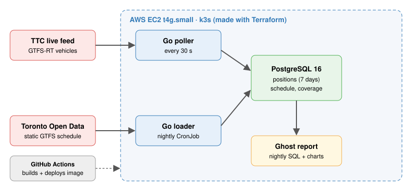

# TTC Ghost Bus Tracker

A small cloud service that watches every TTC bus and streetcar in real time and counts the "ghost" trips: trips on the schedule that never actually showed up.

*How the data flows: live feed and schedule in, ghost report out, all on one small AWS server.*

## How it works

1. A Go **poller** downloads the TTC's live vehicle positions every 30 seconds and saves them to PostgreSQL.
2. A Go **loader** reads the official TTC timetable each night and works out which trips should run each day.
3. A nightly SQL job checks every scheduled trip: if no bus reported that trip ID from 5 minutes before its first stop to its last stop, it's a ghost. Hours when the poller was down are left out.
4. Everything runs on k3s (lightweight Kubernetes) on one EC2 server built with Terraform. I used k3s instead of EKS because the EKS control plane alone costs about US$73 a month.

## How to run it

1. `cd deploy/terraform && terraform apply -var my_ip=$(curl -s ifconfig.me)` creates the server, then follow the `kubeconfig_steps` output.
2. Create the database secret (command is in `deploy/k8s/secret.example.yaml`), then `kubectl apply -k deploy/k8s`.
3. Run the feed check once: `go run ./scripts/feed_check` (takes about 25 minutes, 50 snapshots).
4. Push to `main` and GitHub Actions builds the ARM64 image and deploys it. Check health weekly with `psql -f sql/poll_check.sql`.
5. After 6 weeks: `psql -f sql/ghost_report.sql` and `scripts/export.sh` for the charts.

## What I learned

- Transit timetables have times like `25:10:00` for late-night trips, so a "day" of service doesn't match a calendar day.
- Throwing away duplicate pings and keeping raw data for only 7 days keeps a 2 GB server happy.
- Measuring something honestly means planning for your own downtime, otherwise your outage looks like the TTC's fault.

**Main limit:** a "ghost" can also be a real bus with a broken GPS unit, so the ghost rate is an upper bound on trips that really didn't run.
